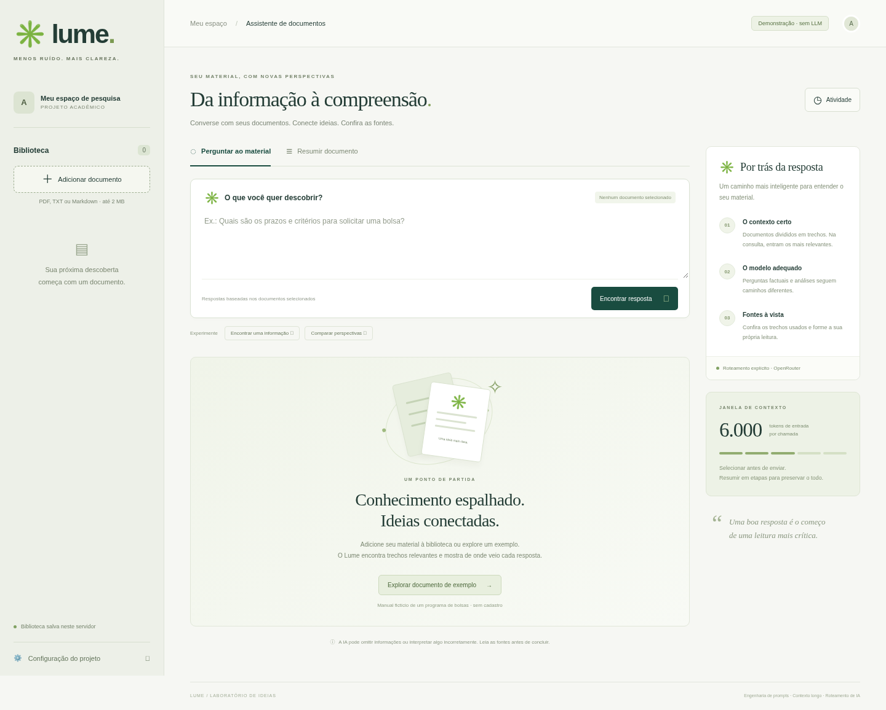

# Lume · Assistente de documentos

MVP acadêmico para consultar materiais extensos com fontes, gerar resumos em etapas e encaminhar tarefas a modelos diferentes pelo **OpenRouter**. Interface em português, upload de PDF/TXT/Markdown, SQLite local e exportação em Markdown.

**Público:** estudantes e equipes acadêmicas que precisam localizar regras, comparar perspectivas e revisar materiais de pesquisa. **Objetivo:** apoiar a leitura crítica com evidências verificáveis, preservando a responsabilidade humana pela interpretação. A proposta corresponde à opção 6 do enunciado.



## Executar

Requisitos: Python 3.11 ou superior. A partir da raiz do repositório, entre na pasta do projeto:

```bash
cd cp3/ai
python -m venv .venv
source .venv/bin/activate
pip install -e '.[dev]'
cp .env.example .env
python -m uvicorn app.main:app --reload --host 127.0.0.1 --port 8000
```

No Windows, ative com `.venv\Scripts\activate` e copie com `copy .env.example .env`.

Abra [http://127.0.0.1:8000](http://127.0.0.1:8000). A documentação da API está em [/docs](http://127.0.0.1:8000/docs). Sem chave, o modo **Demonstração · sem LLM** permite experimentar upload, recuperação, extração de trechos, fontes, resumo extrativo e decisões de roteamento simuladas. Esse modo **não atende sozinho à exigência de executar LLMs pelo OpenRouter**.

### Ativar os modelos reais

Configure no `.env`, somente no servidor:

```dotenv
OPENROUTER_API_KEY=sua_chave
MODEL_FAST=google/gemini-2.5-flash
MODEL_DEEP=anthropic/claude-sonnet-4.5
MODEL_FALLBACK=openai/gpt-4.1-mini
```

Reinicie o servidor. O selo passa a mostrar **OpenRouter configurado**, o que indica presença de chave, sem afirmar conectividade. A primeira análise verifica efetivamente a chamada. Confirme IDs, preços, suporte a JSON e disponibilidade no [catálogo do OpenRouter](https://openrouter.ai/models). Os IDs são valores iniciais configuráveis; sua disponibilidade atual não foi validada neste ambiente.

O ambiente precisa permitir HTTPS para `openrouter.ai`. Neste ambiente de desenvolvimento o domínio ainda não está na lista de saída permitida, e nenhuma chave foi fornecida. A integração foi testada com transporte HTTP simulado, incluindo falhas, sem consumir créditos. Em ambiente com proxy, `httpx` respeita as variáveis de proxy e certificados existentes.

### Experimentar

1. Clique em **Explorar documento de exemplo**. O Manual Aurora é fictício, com cerca de 62 KB, 45 trechos e aproximadamente 22 mil tokens estimados de conteúdo.
2. Pergunte: **Qual é o prazo para solicitar uma bolsa?** Veja os trechos e a escolha do modelo econômico.
3. Pergunte: **Compare as perspectivas da coordenação e dos estudantes sobre a carga horária.** Veja a escolha do modelo de análise.
4. Pergunte: **Qual é o código exclusivo de conferência do último anexo?** Verifique a recuperação de `JACARANDÁ-482`, no final do arquivo.
5. Em **Resumir documento**, selecione só um material e informe o objetivo. Abra os resumos parciais e a sequência de chamadas.
6. Confira as fontes, exporte a análise e consulte **Atividade**. Tente também uma pergunta sem relação com o material.

## Arquitetura

```text
Navegador (HTML/CSS/JavaScript)
    → FastAPI: upload, biblioteca, análise e métricas
        → SQLite: documentos + trechos + histórico de métricas
        → Consulta: BM25 → seleção limitada → roteador → OpenRouter → JSON validado
        → Resumo: todos os trechos → lotes → resumos parciais → redução → síntese
    ← resposta + limitações + fontes originais + rastreamento
```

Python/FastAPI simplifica extração de PDF, persistência e testes. A interface usa JavaScript nativo e não requer Node, build ou serviços adicionais. A busca BM25 permite demonstrar recuperação sem custo adicional de embeddings; suas limitações com sinônimos são explícitas.

| Requisito | Implementação / evidência |
| --- | --- |
| MVP funcional | Biblioteca, consulta, fontes, resumo, exportação e atividade |
| OpenRouter e diferentes modelos | `app/llm.py`; chave no servidor; econômico, análise e fallback |
| Contextos longos | `app/context.py` e `app/service.py`: chunking, BM25, seleção, redução hierárquica |
| Roteamento explícito | Função `route`, motivo e tentativas exibidos na interface |
| Engenharia de prompts | Papel, instruções, exemplos, separação das fontes e esquema validado |
| Avaliação | 25 testes automatizados, seis cenários, relatório local e rubrica humana |
| Contexto social e comunicativo | [Contexto e leitura crítica](docs/contexto-social.md) |
| Apresentação | [Roteiro curto com demonstração](docs/apresentacao.md) |
| Grupo de 2 ou 3 integrantes | [Registro de participação a preencher pelo grupo](docs/equipe.md) |

## Validar

```bash
pytest -q
ruff check app tests scripts
ruff format --check app tests scripts
python scripts/evaluate.py
```

O relatório reproduzível é salvo em `docs/evaluation-demo.json`. A avaliação local mede recuperação, orçamento, abstinência e regras de roteamento; não mede inteligência ou qualidade semântica de LLM.

Para executar os mesmos cenários com LLMs, após configurar chave e rede:

```bash
python scripts/evaluate.py --live --output docs/evaluation-live.json
```

**Este comando consome créditos**, incluindo chamadas de resumo e possíveis fallbacks. Use a [rubrica de avaliação](docs/avaliacao.md) para revisar fidelidade, cobertura e perspectivas. Não publique respostas reais contendo material sensível.

O smoke test de navegador é opcional e requer Playwright e Chromium instalados. Com o servidor rodando em modo demonstração:

```bash
python scripts/browser_check.py http://127.0.0.1:8000
```

O script usa Chromium em `/usr/bin/chromium`, verifica 11 fluxos e salva capturas em `docs/`. A instalação padrão da aplicação não depende do navegador automatizado.

## Estrutura

```text
app/          configuração, persistência, contexto, prompts, roteamento e API
static/       interface responsiva em português
examples/     manual fictício e cenários de avaliação
tests/        testes de contexto, provedor, API e síntese em múltiplos níveis
scripts/      avaliação e verificação no navegador
docs/         documentação, resultados, capturas e apresentação
```

Veja [as decisões técnicas](docs/arquitetura.md) para limites, orçamento, tratamento de falhas e detalhes das fontes.

## Limites de uso

Este MVP foi feito para execução **local, por um grupo**, sem autenticação ou separação de usuários. Os documentos da biblioteca são compartilhados entre quem acessar a instância. Não exponha essa instância diretamente à internet. Para hospedagem compartilhada, serão necessários autenticação, isolamento de documentos, limites de requisição e gestão de retenção.

PDFs precisam conter texto; não há OCR. Há limite de 2 MB, 300 páginas e 500 mil caracteres por documento, 20 documentos na biblioteca e 120 trechos por resumo. O histórico armazena apenas métricas; os textos importados permanecem no SQLite. Remover um documento exclui seus trechos da biblioteca, mas não garante apagamento forense de páginas antigas ou backups do SQLite. Análises exibidas no navegador e arquivos exportados permanecem sob controle de quem os gerou.

No modo real, trechos selecionados e perguntas são enviados ao OpenRouter e ao provedor do modelo. Utilize dados públicos ou sintéticos na demonstração. Fontes válidas não comprovam automaticamente que todas as afirmações da resposta são sustentadas: a conferência humana faz parte do fluxo.
